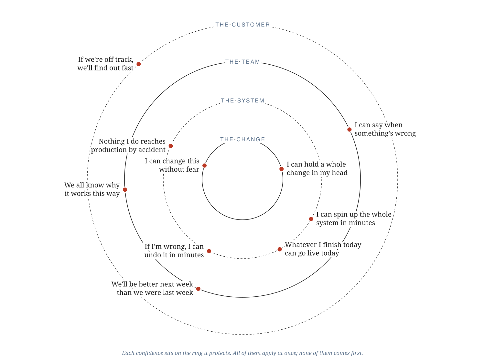
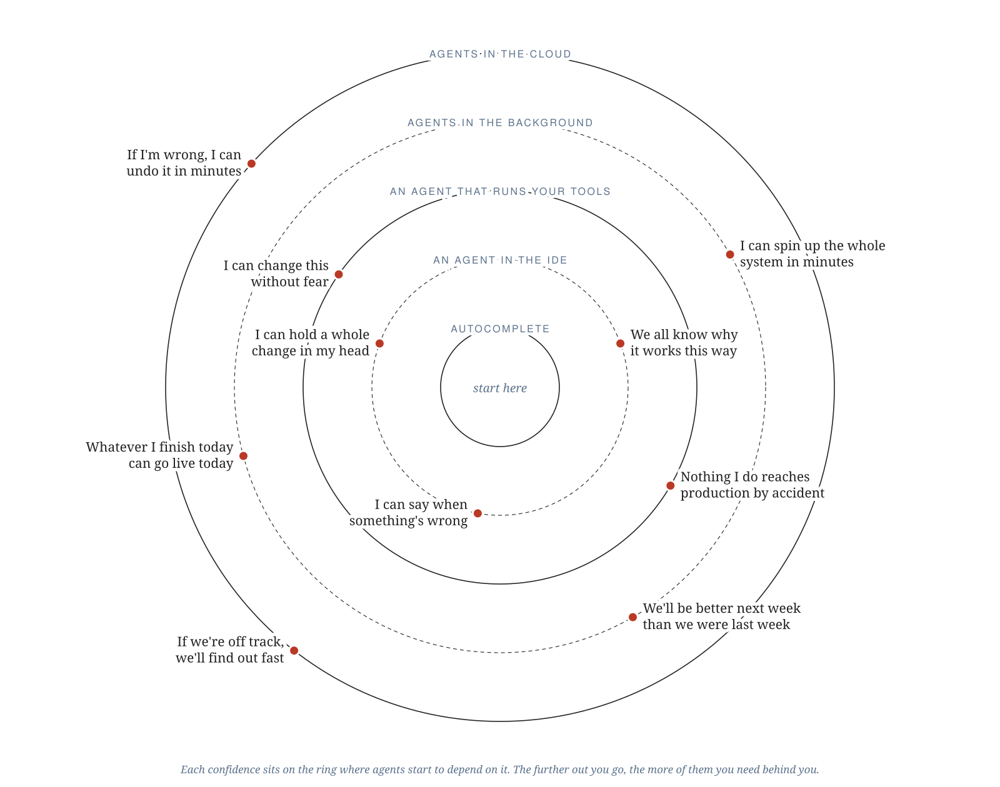
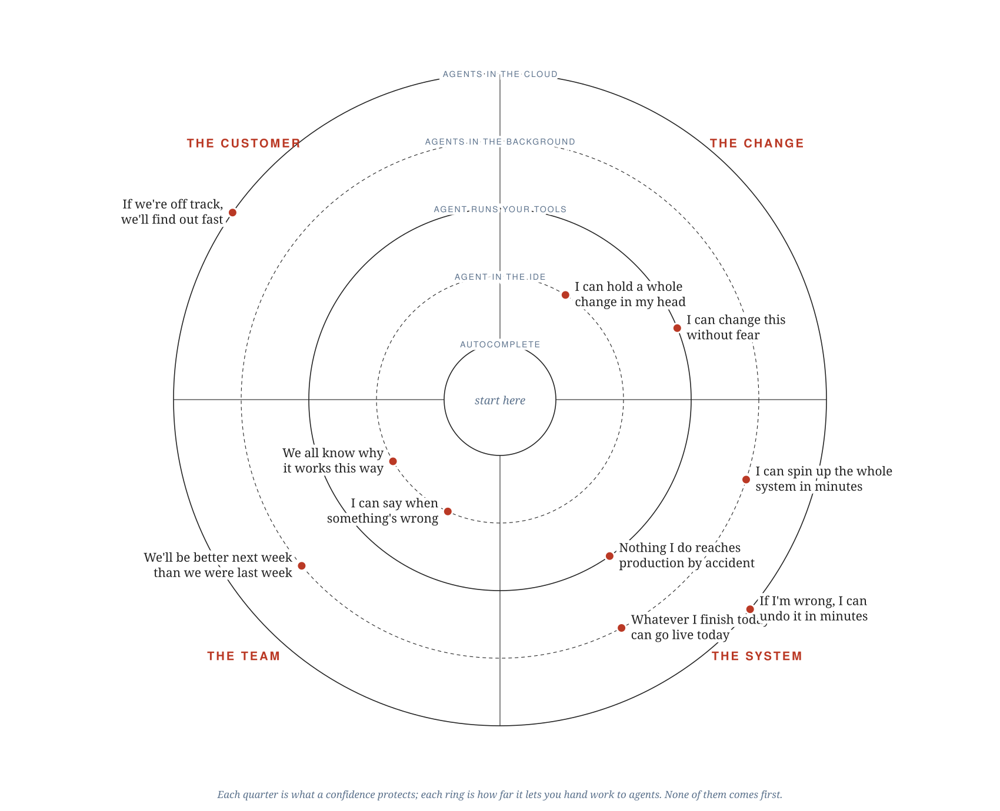

<!-- SHORT VERSION: options 2 and 3 applied, for comparison with mind-the-plumbing.md -->
At the Great Exhibition of 1851, in the glass halls of the Crystal Palace, a plumber named George Jennings installed something most visitors had never used: public flushing toilets. They cost a penny a go (just shy of 80p today), and more than 800,000 people paid for the privilege. It's where the British got the phrase "to spend a penny", which is the gentlemanly way to say you're dropping a deuce.

The flush toilet caught on fast, and the number of water closets in London doubled within a few years. Every one of them sent far more water downstream than the city had ever dealt with. London's cesspits overflowed, so houses were connected to the sewers instead. But the sewers had been built for rainwater, and they emptied straight into the Thames: the river much of London drank from. Cholera swept through the city more than once.

Then came the hot summer of 1858. The river, by now an open sewer, smelled so badly that it became known as the Great Stink. Parliament, right on the riverbank, hung curtains soaked in chloride of lime over its windows. After years of inaction, it passed a bill to fund a proper sewer system in about eighteen days, a speed unheard of then, and, most would say, ever since.

The flush toilet wasn't the problem. It was a triumph of innovation, and nobody seriously suggested going back to chamber pots. But it sent far more downstream, into a system that had never been safe in the first place.

## Spending a penny

Yes, I'm about to compare AI-generated code to sewage. Bear with me; it comes from a positive place.

We've known for decades that **code is a liability, not an asset**. Every line has to be tested, deployed, run, understood and maintained by someone, for as long as it lives. The value is in what it does for the people using it, and a surplus of code isn't, in itself, a net positive.

AI has made producing code almost effortless, the way the flush toilet made disposal effortless. That's a genuine improvement. But all of it still flows downstream: into review, the test suites, the pipeline, production, the cognitive load of whoever changes it next year, and in front of the customers who have to live with it.

Engineering teams constantly trade expediency against sustainability, and the compromises leave behind practices that are risky and unsafe: test suites nobody trusts, deploys that need a particular person, pull requests that sit for days, customers nobody on the team has ever spoken to. At the old volume, we got away with it. The cesspit was nasty, but it held. Turn up the flow, and those compromises don't just become bottlenecks: they overflow.

The wider conversation doesn't help. Many organisations are anxious about AI, and that anxiety has created a market for confidence. As [John Cutler](https://lnkd.in/p/ery_rx26) put it, *the more anxious the buyer, the more reassuring a confident prescription becomes, and the people acknowledging complexity and trade-offs start to sound less credible than the people promising transformation*. I've seen this first-hand: more than one person has read my caution as opposition to Agentic Engineering, which couldn't be further from the truth.

I'm excited about AI, and that's exactly why I take its trade-offs seriously. I'm watching real waste and harm as companies reach for whatever sounds most certain, and I don't want to add false confidence of my own. There's no one-size-fits-all roadmap; this is mine, based on what I've seen work and what I've watched fail. To be direct about where I stand:

* **Ignoring Agentic Engineering is a professional mistake.** Teams that sit this out will fall behind, struggle to have the impact they want, and miss out on what can be, honestly, a lot of fun.
* **Adopting Agentic Engineering without the foundations to carry it is worse than not adopting it at all.** Every place where a team falls short on the fundamentals is a place where AI will make them pay, and pay dearly.

## Why I'm excited

Nobody in 1858 was arguing for a return to the chamber pot, and I'm not arguing for a return to hand-writing every line either.

Lean taught us to see waste: the waiting, the handoffs, the manual checks that gate every release. Once we've worked out the mechanics of something, we teach a machine to do it, and AI has the potential to push that further than anything before. But for me, AI isn't primarily about automation. It's non-deterministic, so I can't trust it to run lights-out. Not yet, anyway.

What I *do* get from it is two things: a rubber duck that talks back, which makes me better at investigating my own thinking, and reach into technologies and APIs I've never used. Both come with [pitfalls](), but as long as I interrogate what comes back rather than trusting the first answer, **I've achieved in days what would previously have taken me weeks.**

Part of why it's worked, I suspect, is twenty-five years of experience. Not because experience stops me believing what an agent makes up; the research suggests it doesn't. But it taught me what good looks like, when something smells off, and how to keep an agent moving in small, reliable steps. Not everyone has had twenty-five years to learn that, which is why collaborative practices matter more than ever.

## The river we drink from

The field is moving so fast that any research is out of date almost as soon as it's published, so take what follows with a pinch of salt. Even so, some patterns are showing up consistently. [DORA's 2024 report](https://dora.dev/research/2024/dora-report/) found that as AI adoption went up, delivery throughput and stability went *down*. The [2025 report](https://dora.dev/dora-report-2025/) explained why: **AI is an amplifier**. It magnifies the strengths of high-performing teams and the dysfunctions of struggling ones. That fits what : speed and stability aren't a trade-off. The foundations are what let you go fast.

Lean has a name for what happens when one step outruns the rest: [overproduction](https://artoflean.com/reference/overproduction/), which Taiichi Ohno called the worst waste of all, because it creates and hides the others. Agents speed up just one part of delivery, producing code, and everything downstream has to absorb the extra volume. But delivery is a loop, not a line. What flows downstream comes back around as the code we have to understand, the bugs we have to fix and the feedback that tells us what to build next.

Victorian London learned the same lesson: the river it was pouring its waste into was the one it drank from. So the real question isn't how fast your agents can write code. It's whether the whole loop can carry what they produce.

## A map across uncharted ground

The predictable answer is a list of practices: do TDD, do trunk-based development, pair, deploy continuously. I've never believed that works. We don't all think alike, and a practice that transforms how one person works can exhaust another. As a neurodivergent person, I know this first-hand. And a leader's job is to make the team you have successful, not the team you wish you had. Copying another team's practices doesn't copy their foundations.

With Agentic Engineering, we're on uncharted ground, so I'd be suspicious of anyone who claims there's a single route across it. Instead, here's my chart so far: the *confidences* I think a team needs to get real value out of AI, with how my team and I got there. That's *my* route, not *the* route.

## The confidences

If I were coaching a team, I'd post each of these on a wall and ask everyone to add sticky notes: *what gives you this confidence today?* and *what keeps you from having it?* The confidence you're shortest on is where AI will cost you first.

### "I can change this without fear"

You can open any part of the codebase, change it, and know within minutes whether you broke something. The signal is a low change failure rate, and a team that doesn't flinch at the parts of the system everyone else avoids. Without it, at the new volume, an unreliable test suite becomes many times more changes nobody can verify.

**My route:** TDD and a fast test suite people actually trust. Characterisation tests around the legacy code nobody dares touch used to take weeks of archaeology; with mutation testing to prove they catch something, AI can write them while you sleep.

Agents can work anywhere in the codebase, including the parts everyone avoids, and check their own work against tests you trust. That trust has to be earned: tests written by the agent that wrote the code tend to confirm what it does, not what it should do. Get it right, and you move from reviewing every line an agent writes to trusting the feedback loop it works inside.


### "If I'm wrong, I can undo it in minutes"

Something goes wrong in production and nobody panics, because putting it right is routine. The signal is a short time to restore service. Without it, at the new volume, more change means more incidents, and if recovery is slow and painful, they start to overlap.

**My route:** good observability, boring rollbacks, smoke tests, and feature flags so that a release and a deploy aren't the same thing.

Agent-written changes can reach production without someone nervously guarding each one. Behind a flag, a bad change is a cheap experiment rather than an incident, and that's what lets you give agents room to try things.


### "Nothing I do reaches production by accident"

The pipeline is the only way in. Nobody can SSH into production on a whim, and the few routes around the pipeline are logged, limited and time-bound. Without it, every privilege you've been tolerating is one you've handed to your agents: an agent running as you can do anything you can do, at machine speed, in your name. And approving each action doesn't survive the volume; by the hundredth request of the day, nobody is really reading them.

**My route:** least privilege by default, no standing access to production, time-limited and audited break-glass access, and infrastructure as code.

The controls on people become the controls on their agents, at no extra cost. Instead of hoping an agent won't do something dangerous, you've made sure it can't, so you can stop approving every command and let it get on with the work.


### "I can spin up the whole system in minutes"

Anyone can bring up a realistic copy of the whole system (the services, the infrastructure, and data with the shape of production) in a sandbox, run it end to end, and throw it away. Without it, at the new volume, agents work blind: an agent that can't see the system doesn't stop and ask, it guesses, fluently and often wrongly.

**My route:** infrastructure as code, every service runnable in an ephemeral environment, on a laptop or in the cloud, and seeded data with the real shape of production that's never the real thing.

Agents can trace a change end to end and fill the gaps from evidence rather than hallucinations. And once the system runs anywhere, you can run several agents in cloud sandboxes, in parallel, while engineers get on with something else. Nothing they do there can hurt anyone, so you can let them roam.


### "Whatever I finish today can go live today"

Small changes flow to production many times a day, and nobody thinks it's remarkable. The signals are deployment frequency and lead time. Without it, at the new volume, a deploy that needs a particular person, or a pull request that waits days for review, becomes the cesspit everything else backs up into.

**My route:** paired trunk-based development, small batches and an automated path to production. This is the confidence I find agents erode first, because [they default to big batches](): a big spec, a big plan, a big diff and a big review.

Several agents in parallel without their work piling up. Small changes are reviewable changes, so more agents means more value delivered rather than a longer queue.


### "I can hold a whole change in my head"

When I pick up a piece of work, I can understand everything it touches: what it changes, what depends on it and what could break. That takes a system with clear boundaries, where a team can change, test and deploy its part without coordinating with everyone else. Without it, at the new volume, every agent change is a change to everything: more context than anyone can hold, and a blast radius nobody can predict.

**My route:** [Domain-Driven Design](https://martinfowler.com/bliki/DomainDrivenDesign.html): bounded contexts drawn around the business rather than technical layers, a ubiquitous language shared with domain experts, and explicit, tested contracts between contexts.

Each change fits inside a boundary an agent can understand in full, and several people's agents can work side by side without stepping on each other. A shared language means less gets lost between the team, the domain experts and the agents.


### "If we're off track, we'll find out fast"

We'll get things wrong; [on a wicked problem](), that's unavoidable. What matters is that it never lasts long: it's routine to hear from the people using what we built, and to change course. Short lead time helps, but lead time stops at production. The loop that matters runs to the customer's reaction, and how long that takes is the closest thing I have to a metric. Without it, agents build the wrong thing as happily as the right one, only faster, and you end up owning more guesses than answers.

**My route:** conversations with customers, small steps, experiments that tell us whether a change moved anything, and throwaway agent-built prototypes that exist only to drive those conversations.

Cheap building becomes cheap learning. Agents prototype the options, and the customer decides which one survives. This is where AI stops being *just* a faster way to write code and becomes a faster way to find out what's worth owning. But learning is something you do first hand.


### "We all know why it works this way"

Decisions are made in the open and understood by more than one person: anyone on the team can explain why the system is the way it is. Without it, at the new volume, more decisions end up in one person's undocumented conversation with a machine, where [nobody else sees them]().

This will be the contentious one. Many people believe we no longer need to know how our software works, because we can always ask the AI. I suspect they've forgotten how it feels when Sales, or a customer, asks why they're seeing what they're seeing, and the best you can say is "I'll have to check and get back to you." An agent can tell you what code appears to do, but the *why* often isn't in the code at all. It lives in the shape and origin of the data, and in history nobody wrote down. In a young greenfield startup, you might get away with asking the AI. In any company with legacy, it's wishful thinking.

**My route:** pairing, rotating pairs, story reviews before work is picked up and after it ships, and [Architecture Decision Records](https://cognitect.com/blog/2011/11/15/documenting-architecture-decisions) for the decisions that matter.

Better instructions, from more people. Language is lossy, and the more the person guiding an agent understands, the less gets lost: the constraints to mention, the unwritten rules about the data, the history behind the odd-looking design. Shared understanding means anyone can steer an agent well, not just the one person who knows where the bodies are buried, and the records of the *why* become context for the agents too.


### "I can say when something's wrong"

Anyone can raise a concern about a change, a decision, a tool or a direction, and it's heard rather than resented. You know you've got it when the most junior person in the room will tell the most senior one "I don't think this is right." Without it, questioning an agent's output, or whether AI is helping at all, starts to feel like standing in the way of progress, so people stop doing it.

**My route:** leaders who go first, admitting their own mistakes and thanking the people who point them out; blameless postmortems; and rituals like [Feedback & Cake]() that make feedback normal.

Problems surface while they're still small: the agent change that looks off, the workflow that isn't paying off, the task that should never have been handed to an agent. In a climate this anxious, that honesty is rare, and it's worth more than any tool.


### "We'll be better next week than we were last week"

The team regularly stops to examine how it works, experiments, and reflects. You know you've got it when this quarter's way of working isn't last quarter's. Without it, at the new volume, the strain lands on the one meeting that could relieve it: retrospectives get pushed, shortened and skipped, and the team stops improving right when it can least afford to.

**My route:** retrospectives with real time set aside, time-boxed experiments with a date to review them, and radical candor.

A team that finds its own route. Agentic tools change faster than anyone can map them, this post included. A team that adapts can try a new agent workflow, see whether it helps, and spread what works, instead of every engineer quietly developing habits alone.


## Muscle and tendon

After Covid, I went back to climbing at my pre-pandemic level far too soon. My arms were ready long before the rest of me was, and I've got a torn rotator cuff to show for it. Muscle adapts in weeks; tendons take months. Ramp up too fast, and the muscle produces more force than the connective tissue can carry.

Agentic Engineering grows the muscle: output goes up almost immediately. The connective tissue (the tests, the pipeline, the shared understanding, the conversations with the customer) adapts at its own pace, and only if you train it. So this is how I think about how far to let an agent run: **give agents as much autonomy as your foundations can carry, and no more.**

Autonomy beyond that is borrowing against your runway, and the early signs are easy to miss. Some engineers are [noticing](https://lnkd.in/p/es9MVCJV) that agents patch the bug in front of them rather than question the design that caused it. Each patch sends a little more downstream, and nobody notices the smell until the weather turns.

## Where I've got to

London knew it had a problem long before 1858; the flush toilets just called in the debt. I see a lot of teams in the same place, with agents calling in theirs: a review queue that keeps growing, incidents that keep repeating, a codebase that's harder to change every month.

So here's my strongest position. **If what's downstream can't carry the flow, turning the flow up just puts more sewage in the river.** Hold back on handing your delivery to agents until it can, and meanwhile, point AI at the foundations you're shortest on. Some of the best uses of AI I've seen have been in digging the sewers.

London's answer was Joseph Bazalgette, who built a sewer network sized for twice the city's population. It's still in use today. London didn't give up the flush toilet. It built something that could carry it, with room to spare. Put the two maps together, and that's my roadmap:

I'm genuinely excited about what AI makes possible, and I want every team I work with to get the most out of it, without burning their runway to find out what it can't do.

So turn up the flow. Just make sure you know where it goes.


You'll notice I haven't used DORA's old elite/high/medium/low tiers. The 2025 report replaced that single ladder with seven team profiles, from "harmonious high-achievers" to teams stuck struggling, and it measures well-being alongside speed and stability. There's no single route to the top, partly because there's no single top. It turns out there's more than one way to be good at this. Who'd have thought?



