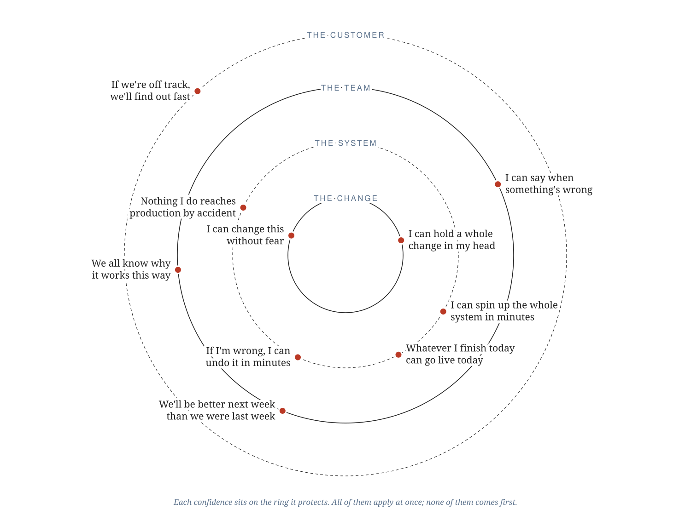
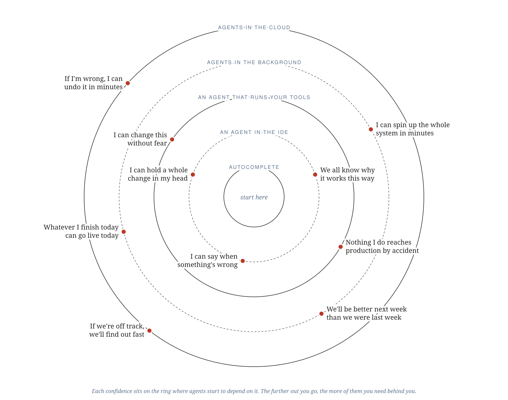
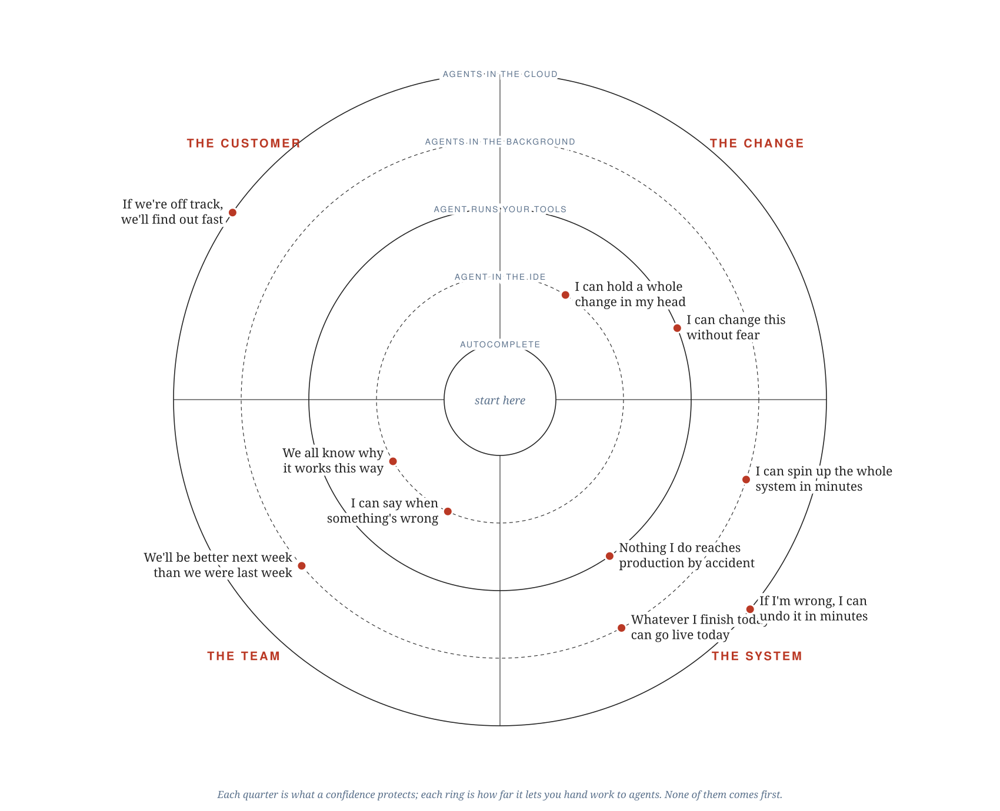

At the Great Exhibition of 1851, in the glass halls of the Crystal Palace, a plumber named George Jennings installed something most visitors had never used: public flushing toilets. They cost a penny a go (I checked, that's just shy of `80p` today), and over the months the exhibition was open, more than 800,000 people paid for the privilege. It's where the British got the phrase "to spend a penny", which is the gentlemanly way to say you're dropping a deuce.

The flush toilet caught on fast. It was cleaner, more convenient and more civilised than anything that came before, and the number of water closets in London doubled over the next few years.

Every one of them sent far more water downstream than the city had ever had to deal with. In those days, London's waste had mostly gone into cesspits, which would now overflowing on a regualr basis. The authorities' answer was to have houses connect their drains to the sewers instead. But the sewers had been built to carry rainwater, and they emptied straight into the Thames: the same river much of London drew its drinking water from. Cholera swept through the city more than once.

Then came the hot summer of 1858. The river, by now an open sewer running through the middle of the capital, began to smell so badly that it became known as the Great Stink. Parliament, which sat right on the riverbank, hung curtains soaked in chloride of lime over its windows. After years of inaction, the politicians were finally forced into action and a bill to fund a proper sewer system passed in about eighteen days, unheared of for those days — and if you ask most people — ever since.

The flush toilet wasn't the problem. It was a triumph of inovation, and nobody seriously suggested going back to chamber pots. But it sent far more downstream, into a system that had never been safe in the first place, and buckled under the new load.

## Spending a penny

Yes, I'm about to compare AI-generated code to sewage. Bear with me; it comes from a positive place.

We've known for decades that **code is a liability, not an asset**. Every line has to be authored, tested, deployed, run, understood and maintained by someone, for as long as it lives. The potential value is in what it does for the people using it, but the wrong code can have a negative impact on the people using it and on the business itself. A surplus of code is not, in and of itself, a net-positive.

AI has made producing that code almost effortless, the way the flush toilet made disposal effortless. That's a genuine improvement, and I'm genuinely excited about it. But all of it still flows downstream: into review, into the test suites, into the deployment pipeline, into production, into the cognitive load of the team who'll have to change it next year, into the battle cards of the sales teams, and in front of the customers who'll have to live with it.

Engineering teams constantly trade expediency against sustainability, and the compromises leave behind practices that are risky and unsafe: test suites nobody trusts, deploys that need a particular person, pull requests that sit for days or weeks, customers nobody on the team has ever spoken to. At the old volume, we got away with it. The cesspit was nasty, but it held. Turn up the flow, and those compromises don't just become bottlenecks: they overflow.

The wider conversation doesn't help. Many organisations are anxious about AI, and that anxiety has created a market for confidence: frameworks, platforms, transformation programmes, anything that promises to make the fear go away. As [the Cutlefish](https://lnkd.in/p/ery_rx26) put it, *the more anxious the buyer, the more reassuring a confident prescription becomes, and the people acknowledging complexity and trade-offs start to sound less credible than the people promising transformation*. I recognise John's observation in first-hand experience, as multiple people have read my acknowledgement of complexity and trade-offs as opposition to the adoption of Agentic Engineering, which couldn't be further from the truth.

I'm excited about AI, and that's exactly why I take its trade-offs seriously. I'm watching real waste and harm as companies reach for whatever sounds most certain, and I don't want to add to it with false confidence of my own. There's no one-size-fits-all roadmap; this is mine: what I believe my teams and I need to get right, based on what I've seen work and what I've watched fail. For us, the opportunity starts with the plumbing. Go all-in without it, and many companies will burn through their runway for little or no return.

Being direct about where I stand, I think there are two halves that matter equally:

* **Ignoring Agentic Engineering is a professional mistake.** Teams that sit this out will fall behind the teams they compete with, they'll struggle to have the impact they want to have, and they're missing out on what can be, honestly, a lot of fun (assuming you derive enjoyment from professional achievement and outcomes).
* **Adopting Agentic Engineering without the foundations to carry it is worse than not adopting it at all.** Every place where a team falls short on the fundamentals is a place where AI will make them pay, and pay dearly.

## Why I'm excited

As far as I know, nobody in 1858 was arguing for a return to the chamber pot, and I'm not arguing for a return to hand-writing every line either.

Lean taught us to see waste: the waiting, the handoffs, the manual steps repeated over and over, the work that adds nothing a customer would pay for. Automation is how we remove much of it. Once we've worked out the mechanics of something, we teach a machine to do it, so nobody has to think about it again: the data ingestion, the pipeline, the deploy, the manual checks that gate every release, the boring bits. AI has the potential to push that further than anything has before, and I'm keen to find out how far.

But for me, AI isn't primarily about automation. It's non-deterministic, which means I can never fully trust it to run lights-out. Not yet, anyway. What I *do* get from it is two things.

The first is a better way to investigate my own thinking: a rubber duck that talks back, in ways that beat the rubber duck. The second is reach. There's a lot I don't know, technologies I've never used, APIs I've never integrated, and AI can get to a huge amount of information very quickly. Both come with pitfalls, and [I've written about some of them](), but as long as I interrogate what comes back rather than trusting the first answer, they let me move much faster than I ever could before.

**In the past year, I've achieved in days what would previously have taken me weeks.** There's no doubt about that in my mind. If you've tried it seriously and still don't believe that, I'd gently suggest looking again. I can't say for sure why it's worked so well for me. Part of it, I suspect, is having twenty-five years of experience under my belt. Not because experience stops me believing the things an agent makes up; the research suggests that it doesn't. But it taught me what good looks like, when something smells off, and how to keep an agent moving in small, reliable steps, so that each one gives me the confidence to take the next. Not everyone has had twenty-five years to learn that, and I worry about how we grow newcomers into experienced engineers in the coming decades. But this is why collborative practices matter more than effer.

The gains are real, and every one of them has depended on what happens downstream of the agent.

## The River We Drink From

The field is moving so fast that any research is out of date almost as soon as it's published, so everything that follows deserves a pinch of salt.

Even so, some patterns are already showing up consistently enough that they're worth listening to. Research by [DORA](https://dora.dev/) tells this story in numbers. The [2024 report](https://dora.dev/research/2024/dora-report/) found that as AI adoption went up, delivery throughput and stability went *down*. The [2025 report](https://dora.dev/dora-report-2025/) put the explanation plainly: **AI is an amplifier**. It magnifies the strengths of high-performing teams, and the dysfunctions of struggling ones. It speeds up development, and that speed exposes whatever is weak downstream.

That fits with what decades of research have found: speed and stability aren't a trade-off. , and it isn't a coincidence. The foundations are what let you go fast.

The same Lean thinking that tells us to automate waste away also warns us about the worst waste of all. Taiichi Ohno called it [overproduction](https://artoflean.com/reference/overproduction/): making more than the next step can use. It's the worst because it creates and hides the others. Work that's been started but can't move on piles up as inventory in front of the bottleneck, waiting, and hiding its defects until someone finally gets to it.

Agents speed up just one part of delivery: producing code. Everything downstream of that has to absorb the extra volume. But software delivery is a loop, not a line. What flows downstream comes back around as the starting point for the next change: the code we have to understand, the bugs we have to fix, the feedback that tells us what to build next. So the strain doesn't stay downstream. It comes back to the production of code itself.

Victorian London learned the same lesson: the river it was pouring its waste into was the one it drank from. So the real question isn't how fast your agents can write code. It's whether the whole loop can carry what they produce.

## A map across uncharted ground

The predictable answer is a list of practices: do TDD, do trunk-based development, pair, deploy continuously. I've never believed that works. We don't all think alike, and a practice that transforms how one person works can exhaust another, or do nothing for them at all. As a neurodivergent person, I know this first-hand. That's why a team should [keep re-evaluating its practices]() rather than inheriting them.

A leader's job is to make their team successful: the team you have, not the team you wish you had. Telling them to adopt every practice and all will be well isn't true, and it isn't helpful. Copying another team's practices doesn't copy their foundations.

And with Agentic Engineering, we're on uncharted ground, so I'd be suspicious of anyone who claims there's a single route across it. 

Instead, here's my chart so far: the *confidences* I think a team needs to get real value out of AI. For each one, I share how my team and I got there, but that's *my* route, not *the* route. If your team reaches the same confidence another way, you've arrived.

## The confidences

If I were coaching a team, this is where I'd start. I'd get everyone in a room, post each of these confidences on the wall, and ask the team to add sticky notes under each one, answering the questions *what gives you this confidence today?*, and *what keeps you from having it?*.

The wall should surface the two things that matter most. **Which confidence is the team shortest on?** That's where AI will cost you first. And **where is the team quietly dumping into the river?** Whatever you've been getting away with at the old volume is what will overflow at the new one.

### "I can change this without fear"

You can open any part of the codebase, change it, and know within minutes whether you broke something. The signal is a low change failure rate, and a team that doesn't flinch at the parts of the system everyone else avoids. Without it, at the new volume, an unreliable test suite becomes many times more changes nobody can verify.

**My route:** TDD and a fast test suite people actually trust. If you lack these today, AI is genuinely brilliant at getting you started: wrapping characterisation tests around the legacy code nobody dares touch used to take weeks of code archaeology. Today, armed with mutation testing to prove those tests actually cover the existing behaviour, AI can do it while you sleep.

Agents can work anywhere in the codebase, including the parts everyone avoids, and check their own work against tests you trust. Earning that trust isn't straight forward: tests written by the same agent that wrote the code tend to confirm what the code does, not what it should do. But get it right with a suitable multi-agent setup, and you take the first step from reviewing every line an agent writes to trusting the feedback loop it works inside.


### "If I'm wrong, I can undo it in minutes"

Something goes wrong in production and nobody panics, because putting it right is routine. The signal is a short time to restore service. Without it, the new volume stings: more change means more things going wrong, and if recovery is slow and painful, every one of them costs more, and they start to overlap.

**My route:** good observability, rollbacks that are boring, smoke tests, and feature flags so that a release and a deploy aren't the same thing.

Agent-written changes can reach production without a person nervously guarding each one. Behind a flag, a bad change becomes a cheap experiment rather than an incident, which is what lets you start giving agents room to try things.


### "Nothing I do reaches production by accident"

The pipeline is the only way in. Nobody can SSH into a production box on a whim and run a command against the database, and the few routes around the pipeline are logged, limited and time-bound. Without it, at the new volume, every privilege you've been tolerating is one you've handed to your agents. An agent running as you can do anything you can do, at machine speed, in your name. And the safeguard most of us lean on — approving what the agent wants to do — doesn't survive the volume: by the hundredth request of the day, nobody is really reading them anymore.

**My route:** least privilege by default, no standing access to production, break-glass access that's time-limited and audited, and infrastructure as code.

The controls you put on people become the controls on their agents, at no extra cost. Instead of hoping an agent won't do something dangerous, you've made sure it can't, and that's what lets you stop approving every command it runs and let it get on with the work.


### "I can spin up the whole system in minutes"

Anyone can bring up a realistic copy of the whole system (the services, the infrastructure, and data with the same shape as production) in a containerised sandbox, run it end to end, and throw it away when they're done. Without it, at the new volume, agents work blind. An agent that can't see how the system behaves, or what the data actually looks like, doesn't stop and ask: it guesses, fluently, and often wrongly.

**My route:** infrastructure as code, every service runnable in an ephemeral environment, on a laptop or in the cloud, and seeded data that reflects the real shape of production without ever being the real thing.

Agents can check their assumptions against the system instead of guessing. With the whole system in a sandbox, an agent can trace a change end to end, meet the data it will actually meet in production, and fill in the gaps from evidence rather than hallucinations. And once the system can run anywhere, it doesn't have to run on an engineer's machine: you can spin up several sandboxes in the cloud and let agents build and test experiments in parallel, while the engineers get on with something else. Because each one is a sandbox, nothing an agent does there can hurt anyone, so you can let it roam.


### "Whatever I finish today can go live today"

Changes flow to production in small pieces, many times a day, and nobody thinks it's remarkable. The signals are deployment frequency and lead time. Without it, at the new volume, a deploy that needs a particular person, or a pull request that waits days for review, becomes the cesspit everything else backs up into.

**My route:** paired trunk-based development, small batches and an automated path to production. This is the confidence I find agents erode first, because [they default to big batches](): a big spec, a big plan, a big diff, and a big review.

Running several agents in parallel without their work piling up. Small changes are reviewable changes, and when each one flows straight to production, more agents means more value delivered rather than a longer queue.


### "I can hold a whole change in my head"

When I pick up a piece of work, I can understand everything it touches: what it changes, what depends on it, and what could break. That's only possible when the system is made of parts with clear boundaries, so a change in one rarely ripples into the others. You know you've got it when a team can change, test and deploy its part of the system without coordinating with everyone else. Without it, at the new volume, every agent change is a change to everything: more context than any agent, or person, can hold, and a blast radius nobody can predict.

**My route:** [Domain-Driven Design](https://martinfowler.com/bliki/DomainDrivenDesign.html): bounded contexts drawn around the business rather than technical layers, a ubiquitous language shared by engineers and domain experts, and explicit contracts between contexts, with tests that hold each side to its contract.

Agents get the same benefit: each change fits inside a boundary they can understand in full, and several people's agents can work side by side without stepping on each other. A smaller world is one an agent is less likely to get wrong. And a ubiquitous language means the team, the domain experts and the agents all use the same words for the same things, so less gets lost between them.


### "If we're off track, we'll find out fast"

We'll get things wrong; [on a wicked problem](), that's unavoidable. What matters is that it never lasts long. You know you've got it when it's routine for the team to hear from the people using what you built, and to change course because of what they learned. Short lead time is part of it, since you can't learn from something nobody has seen, but lead time stops at production. The loop that matters here runs all the way to the customer's reaction, and the closest thing I have to a metric is how long that takes. Without it, cheap building becomes a trap: agents build the wrong thing as happily as the right one, only faster, and you end up owning more guesses than answers, each of them a liability.

**My route:** conversations with customers, small steps, experiments that tell us whether a change actually moved anything, and lately, throwaway prototypes built with agents that exist only to drive those conversations.

Cheap building turns into cheap learning. Agents can prototype several options in the time it used to take to build one, and the customer conversation decides which one survives. This is where AI stops being *just* a faster way to write code and becomes a faster way to find out what's worth owning. None of that work's hands-off. Learning is something you do first hand.


### "We all know why it works this way"

Decisions are made in the open, challenged while they're being made, and understood by more than one person. You know you've got it when anyone on the team can explain why the system is the way it is. Without it, at the new volume, more decisions than ever end up in one person's undocumented conversation with a machine, where [nobody else ever sees them](). Spec-driven development attempts to tackle this, but on its own, [at scale, all it becomes is more documentation no one reads]().

I expect this to be the most contentious confidence on the map. Many people seem to believe that in the age of AI we no longer need to know what our software does, or how, because we can always ask the AI. I suspect they've forgotten how it feels when the Sales team, or a customer, asks whether something is possible, or they're seeing what they're seeing in the product, and the best you can say is "I don't know. I'll have to check and get back to you."

An agent can be very good at reading code and telling you what it appears to do. It's far less able to tell you why it's that way, because the why often isn't in the code or the docs at all. It lives in the shape and origin of the data, in how that data is spread across different stores and structures, and in side effects and history nobody wrote down. Assuming you can always ask the AI is, in my opinion, blind faith. It might hold in a one-year-old greenfield startup. In any company with legacy, it's wishful thinking.

**My route:** pairing, rotating pairs, story reviews before work is picked up and after it's shipped, and [Architecture Decision Records](https://cognitect.com/blog/2011/11/15/documenting-architecture-decisions) for the decisions that matter.

Better instructions, from more people. Agents are guided by people, and language is a lossy medium: no instruction captures everything. The more the person guiding an agent understands about the system, the less gets lost: the constraints they know to mention, the unwritten rules about the data, the history behind the odd-looking design. When that understanding is shared, anyone on the team can steer an agent well, not just the one person who knows where the bodies are buried. And the records that hold the *why* become context your agents can use too.


### "I can say when something's wrong"

Anyone on the team can raise a concern, about a change, a decision, a tool or a direction, and it's heard rather than resented. You know you've got it when the most junior person in the room will tell the most senior one "I don't think this is right." Without it, at the new volume, problems hide in plain sight. Questioning an agent's output, or whether AI is helping at all, starts to feel like standing in the way of progress, so people stop doing it.

**My route:** leaders who go first, admitting their own mistakes and thanking the people who point them out; retrospectives and blameless postmortems; and rituals like [Feedback & Cake]() that make giving and receiving feedback normal.

Problems surface while they're still small. Someone flags the agent change that looks off, the workflow that isn't paying off, or the task that should never have been handed to an agent, without worrying they'll be seen as standing in the way. In a climate this anxious, that honesty is rare, and it's worth more than any tool.


### "We'll be better next week than we were last week"

The team regularly stops to examine how it works, experiment, and reflect. You know you've got it when this quarter's way of working isn't last quarter's. Without it, at the new volume, the strain lands on the one meeting that could relieve it. Retrospectives get pushed, shortened and skipped, and the team stops improving right when it can least afford to.

**My route:** retrospectives with real time set aside, small time-boxed experiments with a date to review, and radical candor.

A team that finds its own route. Agentic tools are changing faster than anyone can map them, this post included. A team that reviews and adapts can try a new agent workflow, see whether it helps, and spread what works, instead of every engineer quietly developing habits on their own.


## Muscle and tendon

I have a tear in my rotator cuff; This might seem unrelated, but bear with me.

Anyone who's taken up a sport seriously as an adult has probably met a version of this. When you train hard, muscle adapts quickly: you can feel yourself getting stronger within weeks. Tendons and ligaments adapt far more slowly, over months. That gap is why people who ramp up too fast get injured: the muscle can now produce more force than the connective tissue can safely carry. Climbers know this well; a beginner's arms get strong long before their fingers do. After Covid I tried to climb at my pre-pandemic level too soon, training hard, I rushed into it and injured myself several times.

Agentic Engineering is like growing a muscle. Output goes up almost immediately. The connective tissue (the tests, the deployment pipeline, the shared understanding, the conversations with the customer) adapts at its own pace, and only if you train it deliberately. And everything that makes agents exciting adds load: bigger tasks, more autonomy, agents running in parallel while you're in a meeting.

So this is how I think about how far to let an agent run. **Give agents as much autonomy as your foundations can carry, and no more.** Autonomy beyond that is borrowing against a debt you might not be able to pay back — take a long hard look at your available runway.

Plot the same confidences against how much you hand to agents, from autocomplete in the IDE to autonomous agents in the cloud, and the shape of that advice becomes clearer:

The early signs of that debt are easy to miss. Some engineers are [noticing](https://lnkd.in/p/es9MVCJV) that when an agent hits a bug, it often patches the one case in front of it rather than question the design that caused it. Each patch is a little more sent downstream, and nobody notices the smell until the weather turns.

## Where I've got to

London knew it had a problem long before 1858. The debt had been building for decades; the flush toilets just called it in. I see a lot of teams in the same place. They've carried debt for years, and agents have started calling it in: a review queue that keeps growing, incidents that keep repeating, a codebase that's harder to change every month. The bill arrives slowly, while the feeling of speed arrives on day one.

So here's the strongest version of my position. **If what's downstream can't carry the flow, turning the flow up just puts more sewage in the river.** Hold back on handing your delivery to agents until it can, and in the meantime, point AI at the foundations you're shortest on. Some of the best uses of AI I've seen have been in digging the sewers.

London's answer was Joseph Bazalgette, who built a sewer network sized for twice the city's population and, . It's still in use today. London didn't give up the flush toilet. It built something that could carry it, with room to spare, and then got on with growing.

Put the two maps together and you have my roadmap: what each confidence protects, and how far it lets you go.

That's what I'd want for any team, whether you've ignored AI so far or jumped in head first. I'm genuinely excited about what AI makes possible, and I want every team I work with to get the most out of it, without burning their runway to find out what it can't do.

So turn up the flow. Just make sure you know where it goes.


You'll notice I haven't used DORA's old elite/high/medium/low tiers. The 2025 report replaced that single ladder with seven team profiles, from "harmonious high-achievers" to teams stuck struggling, and it measures well-being alongside speed and stability. There's no single route to the top, partly because there's no single top. It turns out there's more than one way to be good at this. Who'd have thought?

He's supposed to have said: "we're only going to do this once, and there's always the unforeseen." The quote is repeated everywhere, including by the Institution of Civil Engineers, but I couldn't find a primary source for it, so take it as legend rather than record. The part that's well documented is that the system was sized for a far larger population than London had at the time. There's a lovely irony in the story too: most of the people who pushed for the sewers believed disease spread through bad air, the "miasma" theory, rather than through contaminated water, as John Snow had argued. They built the right thing for the wrong reason. Which, I suppose, is another argument for focusing on the outcome rather than the route.



