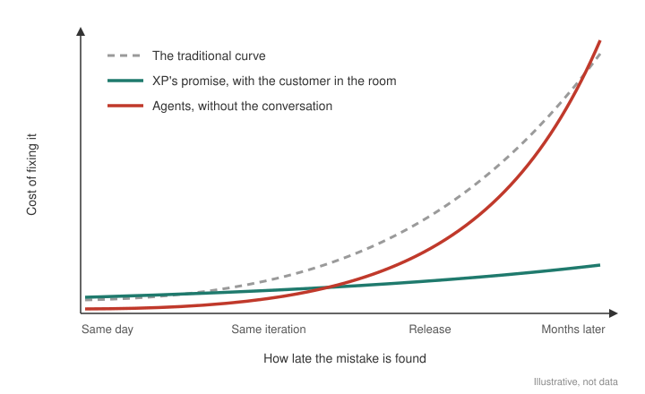


This has a cost, and I've felt it. On the XP teams I've been part of, knowledge lived in conversations, which meant it lived in people. The old-timers knew why the system worked the way it did, and when they left, the reasons often left with them. Tests were meant to be the documentation, and they're good at recording *what* the software does, but in my experience they're poor at recording *why*. I've [written before]() about how much context we lose this way, and it's part of why the appeal of SDD resonates with me. That said, I'm a big advocate of [Architecture Decision Records](https://cognitect.com/blog/2011/11/15/documenting-architecture-decisions) (ADRs) as the answer to this, rather than a spec for every piece of code written. I suspect we'll end up with far more specs than we ever needed ADRs.


There's an interesting argument playing out at the moment, and I think it's one of those cases where both sides make a lot of sense.

On one side are the agile veterans. They watch a team hand an agent a feature request, get back a few thousand lines of `plan.md`, approve it, and let the agent build the lot. They recognise the shape immediately: requirements gathered up front, a big document signed off, a long build, and the customer at the far end of it. *That's waterfall*, they shout. *We spent twenty years getting away from this.*

On the other side are the people actually shipping with agents, who are tired of being told they're doing it wrong by people who learned their craft at a time where many of the constraints were objectively different. The tools have changed. Writing a spec used to be expensive and now it's nearly free. Rework used to be painful and now an agent will rewrite the module before lunch. *Why should the rules from 2001 still apply?*

What they're arguing about is spec-driven development (SDD), and I think both sides are missing some of the nuance. **SDD is going to be misunderstood in exactly the way Agile was.** Used to work out the next small step of a problem *with* the customer, it's genuinely useful, and closer to XP than either camp would like to admit. Used to plan the whole problem ahead of time, it fails, in precisely the way XP set out to avoid.

## Small steps, big specs

The idea behind SDD is simple: before an agent writes any code, you write down what you want built and why, and the agent turns that into a plan and a list of tasks. It answers a real problem agents created: the conversation between an engineer and an agent, where much of the thinking happens, lives in one terminal and is gone when the session ends. A spec gives those decisions somewhere to live.

Its advocates aren't asking for a big spec up front. Many argue for [small steps, each suitably documented](https://brooker.co.za/blog/2026/04/09/waterfall-vs-spec), with the spec evolving alongside the code. But in practice, [some are finding](https://martinfowler.com/articles/exploring-gen-ai/sdd-3-tools.html) that even a small bug fix turns into four user stories with sixteen acceptance criteria. The advocates ask for small steps, and the tools blow them up anyway. Agents make the big spec the path of least resistance, and most of us will take it.

## Why XP put the customer in the room

XP has never been big on specs. The Agile Manifesto, which Kent Beck co-signed, values "working software over comprehensive documentation", and .

But XP bet on conversation over documents for good reasons, and they start with the customer in the room.

When Kent Beck wrote *Extreme Programming Explained* in 1999, the **On-Site Customer** was one of the original twelve practices: a real customer, sitting with the team, answering questions and making priority calls as the work happened.

It's easy to misintepret this as a simple convenience: someone to ask. That was never the point. XP starts from the assumption that requirements are *discovered*, not specified. No document captures them up front, because you don't know what the customer needs until you've built a little and watched them react, and often they don't know either. That's why a user story was never a spec. It's a placeholder for a conversation.

### Talk is cheap

A developer with an unanswered question has two options: stall, or guess. Stalling is expensive, so most people guess, and every guess is a small bet that the team has now taken. Sitting together made an answer cost minutes rather than days, so people ask instead.

**Every line of code is a business decision**. Whether an expired discount still applies at checkout, what happens to a half-finished order, which error a customer sees and what it tells them: none of these feel like business decisions when you're writing them, and all of them are. A developer who isn't regularly talking to the customer, and to the rest of the business, is still making those decisions. They're just making them alone, as the wrong person, without noticing.

I'm a big fan of an internal saying at Spotify — "Talk is cheap" — usually a put-down, the Spotify team use it to mean the opposite: debate thoroughly before building, because talking costs very little and building the wrong thing costs a great deal. That's the economics behind the on-site customer. A five-minute conversation is the cheapest feedback loop there is.

### A wrong guess compounds

Misunderstandings get built on, so the cheapest moment to correct one is the moment it happens. Feedback in minutes beats feedback each iteration, which beats feedback at the end. This is the argument behind pairing, TDD, automated testing, and many other XP practices.

XP went further, and claimed its practices could flatten the cost-of-change curve: with small steps, tests and refactoring, changing your mind late would cost little more than changing it early. It's the same promise people make about agents today. **But XP's flat curve rested on the customer being there to catch the wrong turns early.** Having a customer in the room was always a bet that their time cost less than building the wrong thing. Take them away and the curve bends right back up.

It's also why the practice was about being *together*, not just being available. Context travels through conversation, overheard talk and shared artefacts, not through handoffs. The on-site customer didn't just answer questions. They were around, and the team absorbed the domain by being near it.

The practice didn't survive contact with reality unchanged. In the second edition, in 2004, Beck folded it into Whole Team, with Real Customer Involvement as a corollary practice, something you build up to rather than start with. <!-- VERIFY wording and reasoning --> The industry had found that a full-time customer was hard to come by, and had filled the gap with proxies. Beck didn't drop the principle. He made it a property of the team.

## Skipping the conversation

Agents haven't changed why the conversation matters. They've changed how easy it is to do without it, and what it costs when you do.

### The guess got fluent

The stall is gone. You never have to wait for an answer, because the agent will happily fill the gap, with a business rule that sounds plausible and a justification to match. **But filling the gap is still guessing.** It's just guessing fluently, and at scale, and the developer is now often not even the one making the guess. I [wrote recently]() about how readily we adopt an agent's lean as our own. A business rule invented by an agent, accepted by an engineer and buried in line 412 of a spec is a business decision made by two wrong parties, and neither of them will remember making it.

### Rework only feels cheap

The modern version of the flat-curve claim is that agents make rework cheap. That's true in the short term: if you catch a mistake the same afternoon, an agent really can make undoing it almost free. But the later a decision is reversed, the more has been built on top of it, and agents build on top of things *very* quickly. **Agents flatten the cost of producing code, not the cost of being wrong.**

And it isn't only a theoretical worry. [Some engineers are starting to notice it](https://lnkd.in/p/es9MVCJV) day to day: when an agent hits a bug, it patches the one case in front of it rather than stepping back to question the design that caused it, even when explicitly asked to rethink. Each patch is another thing built on top of the original decision, which makes that decision more expensive to undo. Agents haven't made rework cheaper. They've made it easier to put off.

That changes how the customer bet looks. If rework feels free, the customer's time starts to look expensive by comparison, and putting them in the room looks like a bad trade. That's the trap. The rework only *feels* free because its real cost turns up later, compounded, on someone else's sprint.

### Decisions made alone

More and more decisions are being made in silos: one engineer, one agent, one long conversation nobody else sees. The context still exists. It's just trapped in a chat history.

You could argue agents have broken the "talk is cheap" logic. If building is nearly free too, why bother talking first? But the comparison was never really talk versus building. It was talk versus **being wrong**, and being wrong hasn't got any cheaper. And when we're making more decisions than ever, alone with an agent, **the conversation with another person is the only thing that puts a second mind on them.** Talk is still cheap. It's never been worth more.

## Tame problems and wicked problems

In 1973, Horst Rittel and Melvin Webber published *Dilemmas in a General Theory of Planning*, and gave us a distinction I keep coming back to: **tame problems** and **wicked problems**.

A tame problem can be fully specified before you start. You know when you've solved it, and the solution is either right or wrong. A wicked problem is different: you can't define it until you've tried to solve it, there's no point at which it's clearly done, and every attempt changes the problem. As they put it, the information needed to understand the problem depends on one's idea for solving it. <!-- VERIFY exact quote -->

I want to be clear about this, because the agile camp often isn't: **for tame problems, writing the spec up front is fine, and often the best thing to do.** A CSV parser, a migration between two well-documented APIs, a CRUD service over a known schema. Write it down, hand it to the agent, check the result. That's where spec-driven development earned its reputation, and it deserves it.

Wicked problems are where it breaks. Not because people aren't disciplined enough to write a good spec, but because the information the spec needs **doesn't exist yet**. It's created by building something small, putting it in front of people, and watching what they do with it.

If that sounds like an exaggeration, look at what happens when experts' ideas are actually tested. Ron Kohavi and his colleagues ran online experimentation at Microsoft for years, and found that only about a third of the ideas they tested improved the metric they were designed to improve. On mature products like Bing, the success rate was lower still. <!-- VERIFY figures against Kohavi et al. and "Trustworthy Online Controlled Experiments" (2020) --> These were experienced people, with data, building things they believed in. **A spec is a stack of untested ideas**, and on a wicked problem most of them will be wrong in ways nobody can see until they meet users.

## Wicked problems in disguise

The obvious wicked problems aren't the dangerous ones. Nobody sits down to spec "fix healthcare" in one go. The dangerous ones look tame: a checkout flow, an onboarding form, a reporting dashboard. They look like CRUD until real people start using them, and then they turn out to be about trust, or fear, or politics, or something nobody in the planning meeting would have guessed.

<!--
ANECDOTE GOES HERE. Candidates so far: the Lucky Iron Fish (shape mattered more
than chemistry; later, possibly the wrong problem), Nextdoor's posting flow
(adding friction reduced racial profiling), M-Pesa (built for loan repayments,
used to send money home). Ideally something surprising that only showed up
because someone shipped a small step and watched.
-->

> **[Anecdote: a problem that looked tame, and a discovery that no up-front spec would have contained.]**

**You often can't tell a problem is wicked until you've started building it.** Which means the first step of any spec has to be small enough to tell you what kind of problem you're dealing with.

## Why we reach for the big spec anyway

So if most of a big spec is going to be wrong, why does it keep winning?

I've [written before]() about the path of least resistance, and this is another version of it. **The customer's attention is the scarcest thing on any project.** Every conversation has to be booked, prepared for and followed up. Writing everything down once, and sparing everyone the conversations, is enormously tempting. Agents have made it almost free. So specs balloon, because the cheapest thing to produce is more spec.

It doesn't help that a big spec *feels* like progress. In METR's 2025 study, experienced open-source developers were measurably slower with AI tools, while believing they'd been faster. <!-- VERIFY numbers --> A few thousand lines of well-structured spec feel like a lot of progress. They might not be.

And for most engineers, the customer was never in the room anyway. In most companies I've worked with, the customer isn't someone who turns up asking for things. It's someone the sales team spent months courting, and account managers can be fiercely protective of them, often with good reason. Engineers are honest about the product in ways that can be alarming to a customer who's still deciding whether to trust you. So there are guardrails, and gatekeeping, and an hour a fortnight if you're lucky.

XP's on-site customer assumed access that most teams simply don't have. The big spec is what fills the gap.

Multiply that across an industry and you get the numbers we're starting to see. <!-- TODO: DORA 2025 on user-centric focus, if it says what I think it says; CircleCI 2026 State of Software Delivery figures on spend vs. outcomes --> [Placeholder: we're spending more on AI than ever, and getting less back.]

## Where SDD and XP actually agree

Here's the part I think both camps miss. **Test-driven development was always spec-driven development, at the smallest possible scale.** You write the spec as a failing test, make it pass, and find out what you got wrong. XP's story cards and acceptance tests were specs too. Nobody in XP was against writing down what you intend to build.

So the real argument isn't spec versus no spec. It's **how far ahead of the feedback the spec runs.** A spec for the next small step, written with the customer and checked against their reaction before the next one is written, is about as XP as it gets. A spec for the whole problem, written before anyone outside the team has seen anything, is the thing the old men are shouting about, and they're right to.

Step size matters for another reason. A big spec bundles together requirements from different people, and some of them will conflict: sales wants one thing, support wants another. A customer in the room would make someone choose. An agent won't. Hand it two conflicting requirements and it will find a way to satisfy both on paper, which usually means neither in practice. The conflict doesn't get resolved; it gets hidden, somewhere deep in a large change nobody reads closely. Small steps surface those conflicts while there's still someone to settle them.

## Using agents to get to the customer

If the agent can build something before the meeting is booked, then maybe the meeting should be about what it built.

One approach I've been experimenting with: build a throwaway prototype, and when you show it to a customer, frame it as **something you built for a different customer**. It isn't scalable, it isn't for sale, and it isn't on the roadmap. You're showing it to them because they seem engaged in the problem and you'd value their reaction. <!-- TODO: finish this thought, the original message was cut off -->

That framing does a lot of work. It lowers the stakes for the sales team, because nobody is promising anything. It lowers the stakes for the customer, who can be honest without worrying they're committing to it. And it uses the agent's speed to *start* the conversation, instead of using it to avoid one.

## Where I've got to

The old men are right: the customer matters more than the spec, and on wicked problems a spec that runs ahead of the feedback will be wrong in ways that compound. The young people are right too: the tools really have changed, and the way we reach the customer, and what we bring to them, should change with them.

**Write the spec for the next step, not the whole problem.** Then go and find out what you got wrong.


